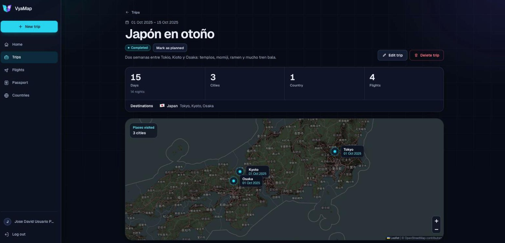
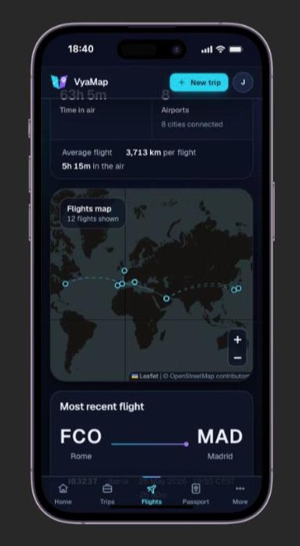
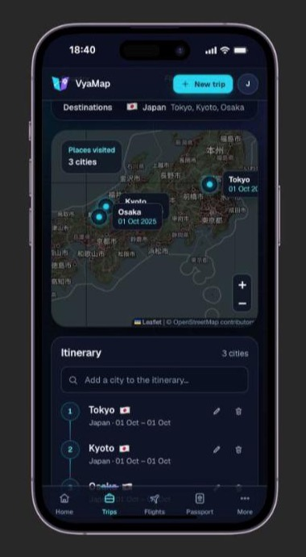
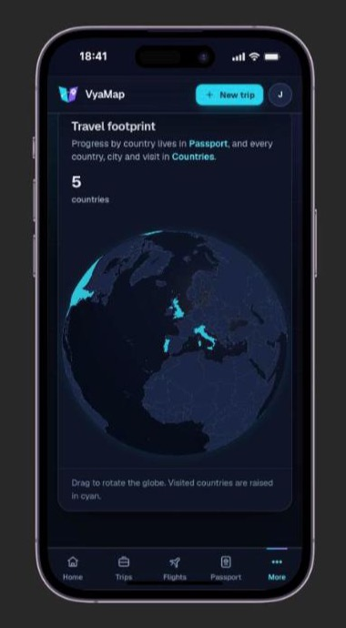

# VyaMap

VyaMap es una aplicación web personal para registrar, visualizar y explorar el historial de viajes: viajes, ciudades visitadas, vuelos y fotos, con mapas y estadísticas derivadas de esos datos.

> My History → Map → Discover → New Trip → My History

Es un proyecto en desarrollo y de uso personal. La arquitectura y sus decisiones están en [`docs/architecture.md`](docs/architecture.md).

**Demo:** [vyamap.josedavidfernandezcomino.com](https://vyamap.josedavidfernandezcomino.com). Se entra con el botón «Try the demo», que abre una cuenta demo de solo lectura.

## Capturas

### Escritorio

| Inicio | Viaje |
|---|---|
|  |  |

| Vuelos | Pasaporte |
|---|---|
|  |  |


### Móvil

<p align="center">
  
  
  
  
  
</p>

## Funcionalidades implementadas

- **Viajes** con fechas y estado: planificado, completado o cancelado. El cambio de estado es siempre manual y está limitado a unas transiciones concretas (un viaje no se completa solo por la fecha). Para los planificados se deduce si son próximos, están en curso o están pendientes de confirmar.
- **Visitas** a ciudades dentro de cada viaje. Solo los viajes completados cuentan como lugares visitados.
- **Catálogo compartido** de países, ciudades y aeropuertos, con alias de ciudades y fusión reversible de duplicados.
- **Vuelos** asociados a un viaje o independientes:
  - fecha local de salida obligatoria; horas en formato de 24 horas, número de vuelo y aerolínea opcionales;
  - horas interpretadas en la zona horaria de cada aeropuerto y guardadas en UTC;
  - estado deducido (próximo, realizado, pendiente de confirmar o cancelado) y confirmación manual;
  - al borrar un viaje, sus vuelos se conservan como independientes.
- **Flight History**: lista, mapa de rutas con arcos de círculo máximo, filtros y gestión de vuelos.
- **Países**: listado y detalle, distinguiendo Estados soberanos (porcentaje sobre los 193 miembros de la ONU) y territorios.
- **Dashboard y Passport**: resúmenes, mapas, viajes recientes, viajes por año y vuelos.
- **Fotos privadas**: las ya subidas se sirven solo a su propietario, con álbumes; listas de Google Maps asociadas a viajes. La subida de fotos y avatares está desactivada (`UPLOADS_ENABLED`); el procesado en cola (variantes, fecha y ubicación EXIF) sigue en el código.
- **Cuentas**: autenticación con Laravel Fortify, límites de frecuencia en el acceso y registro público solo en entorno local salvo que se active, con un máximo de cuentas configurable (en el resto, las cuentas se crean con `php artisan users:create`; `php artisan users:list` las lista). La subida de fotos y avatares se puede desactivar (`UPLOADS_ENABLED`).

## Stack

| Capa | Tecnologías |
|---|---|
| Backend | PHP 8.3+, Laravel 13, Laravel Fortify, Laravel Sanctum, Intervention Image (GD) |
| Base de datos | MySQL 8 en local; MariaDB 10.5 en producción |
| Frontend | Vue 3, TypeScript, Inertia.js, Tailwind CSS 4, Vite 6 |
| Mapas | Leaflet; three-globe para el globo del perfil |
| Pruebas | PHPUnit (Laravel), Vitest con @vue/test-utils y happy-dom, vue-tsc |

## Requisitos

- PHP 8.3 o superior, con la extensión GD
- Composer
- Node.js y npm
- MySQL 8

## Instalación en local

```bash
composer install
npm install

cp .env.example .env
php artisan key:generate
```

En `.env`, configura la base de datos (`DB_*`) y, si hace falta, la zona horaria del usuario (`APP_USER_TIMEZONE`, por defecto `Europe/Madrid`). No subas `.env` a Git.

```bash
php artisan migrate
```

### Catálogo de países, ciudades y aeropuertos

Los datos están en el repositorio, en [`database/data/catalog/`](database/data/catalog/README.md) (con su origen y licencia). Los comandos los leen de `storage/app/data/`, así que primero se copian allí:

```bash
mkdir -p storage/app/data && cp database/data/catalog/*.csv storage/app/data/
```

Comandos y archivo que lee cada uno:

| Comando | Archivo |
|---|---|
| `php artisan countries:import --apply` | `countries.csv` y `countries_overrides.csv` |
| `php artisan cities:import` | `vyamap_airport_city_mapping.csv` |
| `php artisan app:import-airports` | `vyamap_airport_city_mapping.csv` |
| `php artisan airports:map-cities --apply` | `vyamap_airport_city_mapping.csv` |
| `php artisan airports:enrich-coordinates --apply` | `airports.csv` |
| `php artisan airports:import-timezones --apply` | `airport_timezones.csv` |

Hay que ejecutarlos en este orden: cada ciudad pertenece a un país, y los tres últimos trabajan sobre aeropuertos y ciudades que ya existen. Sin `--apply`, los comandos que lo admiten solo simulan; `php artisan help <comando>` muestra sus opciones.

### Usuario y arranque

```bash
php artisan users:create "Nombre" correo@example.com   # pide la contraseña
npm run dev                                             # Vite en desarrollo
composer run queue                                      # worker de la cola (procesado de fotos)
```

La aplicación se sirve con el servidor web local o con `php artisan serve`. Con `QUEUE_CONNECTION=sync` (el valor de `.env.example`) las fotos se procesan al subirlas; con `database` hace falta el worker de cola, y sin él se quedan pendientes.

### Datos de demostración

```bash
php artisan demo:reset correo@example.com
```

Sustituye los viajes, visitas y vuelos de **esa** cuenta por el historial ficticio de una persona que vive en Madrid: 13 viajes completados entre 2024 y 2026 (16 países y Gibraltar, en cuatro continentes), uno cancelado, uno planificado que siempre empieza 45 días después de ejecutarlo, y 35 vuelos (con escala, llegadas al día siguiente, algunos sin horas y dos independientes confirmados). Solo usa ciudades y aeropuertos del catálogo. Se niega si la cuenta tiene fotos o si falta el catálogo, y pide confirmación. Úsalo solo con una cuenta de demostración.

### Producción

Ver [`docs/deployment.md`](docs/deployment.md): despliegue en un VPS con Plesk (nginx + Apache, PHP-FPM 8.3, MariaDB y HTTPS con Let's Encrypt) mediante Plesk Git y Laravel Toolkit, con registro limitado, copias de seguridad y comprobaciones.

## Pruebas

Los tests de PHP usan una base de datos exclusiva configurada en `.env.testing`, que no se versiona. La plantilla es `.env.testing.example`, y el procedimiento completo está en [`docs/architecture.md`](docs/architecture.md) («Configuración del entorno de testing»). **Los tests borran y recrean las tablas de esa base de datos**: nunca debe apuntar a una con datos reales.

```bash
php artisan test        # PHPUnit
npm run test:js         # Vitest (componentes Vue)
npx vue-tsc --noEmit    # comprobación de tipos
```

## Documentación

- [`docs/architecture.md`](docs/architecture.md): arquitectura, reglas del dominio, seguridad y testing.
- [`docs/frontend.md`](docs/frontend.md): frontend.
- [`docs/VyaMap_Map_System.md`](docs/VyaMap_Map_System.md) y [`docs/VyaMap_ADR-001_Separate_Map_Contexts.md`](docs/VyaMap_ADR-001_Separate_Map_Contexts.md): sistema de mapas.
- [`docs/roadmap.md`](docs/roadmap.md): plan de desarrollo.
- [`docs/manual-testing.md`](docs/manual-testing.md): pruebas manuales por prioridad.
- [`docs/deployment.md`](docs/deployment.md): despliegue en un VPS con Plesk.

## Estado del proyecto

Implementado: viajes con estados, visitas, catálogo, vuelos independientes con su gestión completa, fotos privadas y las páginas descritas arriba.

Implementado también: estadísticas de viaje calculadas en el servidor (días viajando sin solapes, países y primeras visitas por año, continentes y estadísticas de vuelo).

Pendiente, según el plan: la reorganización completa de las páginas, sugerencias asistidas e importación de vuelos desde CSV. El catálogo de aerolíneas está aplazado.

## Licencia

- **Código:** [MIT](LICENSE).
- **Catálogo de países, ciudades y aeropuertos** ([`database/data/catalog/`](database/data/catalog/README.md)): generado desde fuentes de dominio público (OurAirports, base de datos tz de IANA, Natural Earth) y CC0 (Wikidata); el origen de cada archivo está en su README.
- **Mapa de países** (`resources/data/world.geo.json`): polígonos de [Natural Earth](https://www.naturalearthdata.com/) (dominio público), reducidos al código ISO y al nombre de cada país.
  El navegador descarga `public/data/world.topo.json`, que se genera desde ese GeoJSON sin simplificar la geometría: solo comparte las fronteras y cuantiza las coordenadas (unos 0,036°, menos de medio píxel en el mapa de países y en el globo). Si se cambia el GeoJSON, se regenera con:

  ```bash
  npx -p topojson-server@3.0.1 geo2topo -q 1e4 countries=resources/data/world.geo.json > public/data/world.topo.json
  ```
- **Imágenes genéricas** ([`public/images/stock/`](public/images/stock/CREDITS.md)): CC0, con sus autores en `CREDITS.md`.
